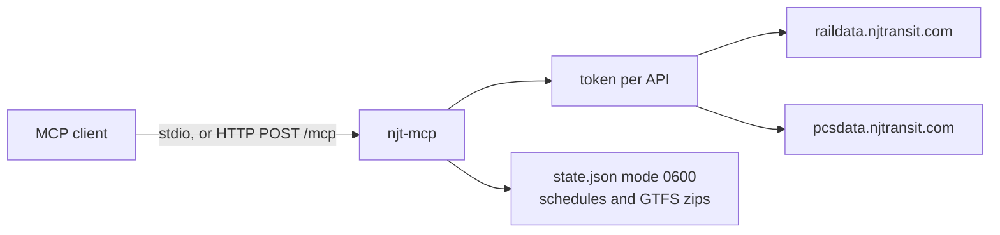

# njt-mcp

MCP server for NJ Transit rail, bus, and light rail. It calls the developer-portal form APIs (TrainData, GTFSRT, GTFSG2, BUSDV2), caches what NJ Transit asks callers not to hammer, and decodes GTFS-Realtime protobufs into compact JSON.

NJ Transit data terms apply to anything this server returns. Register at <https://developer.njtransit.com/registration>, create an app, and request access to each API separately. A credential that works for one product is not access to the others.

## Why Rust

The server is a long-running agent tool, same shape as [`gtfs-mcp`](https://github.com/sohampatwardhan/gtfs-mcp) ([npm `gtfs-mcp` 0.3.0](https://www.npmjs.com/package/gtfs-mcp)):

- `rmcp` speaks stdio and streamable HTTP.
- `prost` decodes the vendored GTFS-Realtime schema.
- One static binary. Release builds use thin LTO, `opt-level = "z"`, and stripped symbols.
- `gtfs-mcp` keeps its GTFS parser private, so this crate vendors the same protobuf and parses the few static files the tools need (stops, routes, trips, stop times, and `trips_internal.txt` when the bus zip has it).

## Architecture



Login is single-flight and cached. Live responses sit in memory for `NJT_RT_TTL` seconds (default 30). `rail_schedule` is stored on disk and fetched at most once per station per America/New_York day.

## Install as an MCP server

After 0.1.0 is published, the usual install is the npm launcher. It has no install scripts. The first run downloads the matching GitHub Release archive, checks `sha256sums.txt`, caches the binary, and runs it. `npx -y njt-mcp` with no subcommand exits. `stdio` is the MCP transport.

```bash
npx -y njt-mcp --version
NJT_USERNAME=replace-me NJT_PASSWORD=replace-me npx -y njt-mcp stdio
```

`NJT_MCP_BINARY` points at a local binary and skips the download. `HTTPS_PROXY` (or `https_proxy`, then `HTTP_PROXY`) is used when set. `NO_PROXY` skips the proxy for matching hosts.

The same launcher is also `@sohampatwardhan/njt-mcp` on GitHub Packages. npmjs.org `njt-mcp` is the usual install.

From crates.io, once the crate exists:

```bash
cargo install njt-mcp --locked
```

Prebuilt archives, checksums, and installers are attached to [GitHub Releases](https://github.com/sohampatwardhan/njt-mcp/releases):

| Archive | Platform |
| --- | --- |
| `njt-mcp-x86_64-unknown-linux-musl.tar.gz` | Linux x64, static musl |
| `njt-mcp-aarch64-unknown-linux-musl.tar.gz` | Linux arm64, static musl |
| `njt-mcp-aarch64-apple-darwin.tar.gz` | macOS arm64 |
| `njt-mcp-x86_64-apple-darwin.tar.gz` | macOS x64 |
| `njt-mcp-x86_64-pc-windows-msvc.zip` | Windows x64 |

`scripts/install.sh` and `scripts/install.ps1` download one of those archives and check `sha256sums.txt`. `NJT_MCP_VERSION=0.1.0` selects a release. Unset uses the latest release.

Credentials are environment variables only. There are no username, password, or token flags. `replace-me` is a placeholder. Do not commit a real credential. Use `NJT_USERNAME` and `NJT_PASSWORD`, or `NJT_TOKEN` alone. A token-only process cannot mint a replacement when NJ Transit rejects the token.

### Claude Desktop and Cursor

Claude Desktop reads `claude_desktop_config.json` (`~/Library/Application Support/Claude/claude_desktop_config.json` on macOS, `%APPDATA%\Claude\claude_desktop_config.json` on Windows). Cursor reads `.cursor/mcp.json` or `~/.cursor/mcp.json`. Both use `mcpServers`.

```json
{
  "mcpServers": {
    "njt-mcp": {
      "command": "npx",
      "args": ["-y", "njt-mcp", "stdio"],
      "env": {
        "NJT_USERNAME": "replace-me",
        "NJT_PASSWORD": "replace-me"
      }
    }
  }
}
```

Token-only, same files:

```json
{
  "mcpServers": {
    "njt-mcp": {
      "command": "npx",
      "args": ["-y", "njt-mcp", "stdio"],
      "env": {
        "NJT_TOKEN": "replace-me"
      }
    }
  }
}
```

### VS Code

`.vscode/mcp.json` uses `servers` and `"type": "stdio"`:

```json
{
  "servers": {
    "njt-mcp": {
      "type": "stdio",
      "command": "npx",
      "args": ["-y", "njt-mcp", "stdio"],
      "env": {
        "NJT_USERNAME": "replace-me",
        "NJT_PASSWORD": "replace-me"
      }
    }
  }
}
```

### Claude Code

`-e` is `--env`. The name comes before `-e`. Everything after `--` is the process, which is `npx -y njt-mcp stdio`.

```bash
claude mcp add njt-mcp \
  -e NJT_USERNAME=replace-me \
  -e NJT_PASSWORD=replace-me \
  -- npx -y njt-mcp stdio
```

```bash
claude mcp add njt-mcp -e NJT_TOKEN=replace-me -- npx -y njt-mcp stdio
```

### Codex

`~/.codex/config.toml`:

```toml
[mcp_servers.njt-mcp]
command = "npx"
args = ["-y", "njt-mcp", "stdio"]

[mcp_servers.njt-mcp.env]
NJT_USERNAME = "replace-me"
NJT_PASSWORD = "replace-me"
```

Token-only, replace the env table with `NJT_TOKEN = "replace-me"`.

### Streamable HTTP

`http` listens on `127.0.0.1:8092`. MCP is `http://127.0.0.1:8092/mcp`. Liveness is `GET /healthz`. Put the credential variables on that process. `Host` must be `localhost`, `127.0.0.1`, or `::1` unless you pass `--allowed-host`.

```bash
NJT_USERNAME=replace-me NJT_PASSWORD=replace-me npx -y njt-mcp http
```

## Build from source

Rust 1.88 or newer. The GTFS-Realtime schema is vendored in `proto/gtfs-realtime.proto` (Apache-2.0) and compiled with a vendored `protoc`, so a system protobuf compiler is not required. `cargo test` does not call NJ Transit.

```bash
git clone https://github.com/sohampatwardhan/njt-mcp
cd njt-mcp
cargo build --release --locked
./target/release/njt-mcp --version
```

`cargo install --path . --locked` installs that binary. `NJT_MCP_BINARY=./target/release/njt-mcp npx -y njt-mcp stdio` uses it without downloading a release.

## Run

Logs go to stderr. stdio mode does not write logs to stdout.

```bash
NJT_USERNAME=replace-me NJT_PASSWORD=replace-me npx -y njt-mcp stdio

# Pre-minted token. This process cannot refresh it.
NJT_TOKEN=replace-me npx -y njt-mcp stdio

# The same subcommands after cargo install, or with a release binary on PATH.
NJT_USERNAME=replace-me NJT_PASSWORD=replace-me njt-mcp stdio

# Streamable HTTP on 127.0.0.1:8092. MCP at /mcp, liveness at /healthz.
NJT_USERNAME=replace-me NJT_PASSWORD=replace-me njt-mcp http
```

`replace-me` is a placeholder. Do not commit a real username, password, or token.

## Configuration

Credentials come only from the environment. There are no credential flags.

At least one complete form is required:

- `NJT_USERNAME` and `NJT_PASSWORD`, or
- `NJT_TOKEN`, or
- both.

Empty values are ignored. If neither form is complete, the process exits with status 1 and names the variables. A malformed optional value also exits with status 1 before the server listens. Those errors do not include credential values.

When both forms are set, each API is called with `NJT_TOKEN` first. If NJ Transit returns an invalid-token error, the server mints a token for that API with the username and password and retries once. Token-only mode cannot mint. The tool error says the token expired and tells you to set a username and password or restart with a fresh `NJT_TOKEN`.

NJ Transit mints tokens per API (`getToken` on TrainData and GTFSRT, `authenticateUser` on GTFSG2 and BUSDV2). Swagger does not say a token from one product is accepted by another. This server does not assume that. One `NJT_TOKEN` is sent to every API and is kept only for the APIs that accept it. There is no per-API token variable; if you need different tokens, set the username and password and let the server mint them.

| Variable | Required | Meaning |
| --- | --- | --- |
| `NJT_USERNAME` | with password | Developer-portal username. |
| `NJT_PASSWORD` | with username | Developer-portal password. Never logged. |
| `NJT_TOKEN` | or the pair above | Pre-minted token. Tried on every API. Never logged. |
| `NJT_ENV` | no | `production` (default) or `test`. |
| `NJT_CACHE_DIR` | no | Token, schedule, and GTFS cache. Default `$XDG_CACHE_HOME/njt-mcp` or `~/.cache/njt-mcp`. `state.json` is mode `0600`. |
| `NJT_RT_TTL` | no | Live response cache, seconds, 5–300. Default 30. |
| `NJT_GTFS_TTL` | no | Static zip age, seconds, 0–604800. Default 43200. `0` keeps the first zip until you delete it. |
| `NJT_RAIL_ORIGIN` | no | Override the rail origin. No userinfo or path. Default follows `NJT_ENV`. |
| `NJT_BUS_ORIGIN` | no | Override the bus origin. Same rules. |
| `NJT_MCP_BIND` | no | HTTP listen address. Default `127.0.0.1:8092`. |
| `NJT_MCP_ALLOWED_HOST` | no | Extra `Host` values, comma-separated. Localhost is always allowed. |
| `NJT_MCP_LOG` or `RUST_LOG` | no | stderr tracing filter. |

Origins:

| `NJT_ENV` | Rail | Bus |
| --- | --- | --- |
| `production` | `https://raildata.njtransit.com` | `https://pcsdata.njtransit.com` |
| `test` | `https://testraildata.njtransit.com` | `https://testpcsdata.njtransit.com` |

Test hosts are for portal credentials that were issued against the test environment.

## Tokens and quotas

| Product | Login | Local mint cap |
| --- | --- | --- |
| TrainData | `POST /api/TrainData/getToken` | 8 / New York day |
| GTFSRT | `POST /api/GTFSRT/getToken` | 8 / New York day |
| GTFSG2 | `POST /api/GTFSG2/authenticateUser` | 4 / New York day |
| BUSDV2 | `POST /api/BUSDV2/authenticateUser` | 4 / New York day |

Rail login is published at about 10 calls per day, and `isValidToken` counts. This server never calls `isValidToken`. It treats `{"errorMessage":"Invalid token."}` as rejection. Bus tokens last about 24 hours.

Other local caps, per America/New_York day:

- `getStationSchedule`: 4 upstream calls (published limit 5). A station already fetched today is served from disk and does not count again.
- Live calls (departures, vehicles, GTFS-Realtime, nearby search): 2000 (published current-data budget 40,000). Do not poll.

An upstream body `{"errorMessage":"Daily usage limit:…"}` is returned as a tool error and that path is not retried until the next New York day. A body that is the literal `Null` means a parameter was missing or invalid. `{"Authenticated":"False","UserToken":""}` is a rejected password and is not retried for the life of the process.

If an API returns 401 or 403, or a body that is not the documented JSON, the tool error says the account may lack access. Tools stay listed, because probing every API at startup would spend the login budget. `njt_status` shows the last error per product and does not show secrets.

## Tools

| Tool | What it answers |
| --- | --- |
| `njt_status` | Credential mode, quotas, cache flags, last error. No secrets. |
| `rail_stations` | Station code, name, 14-character name, wheelchair access. |
| `rail_departures` | Next departures, stops, and station messages. Optional `line` uses the 19-record call. |
| `rail_station_messages` | Messages for a station, a line, or both. |
| `rail_train_stops` | Stops for one train id. |
| `rail_vehicles` | Recent rail positions, next stop, seconds late. Optional train or line filter. |
| `rail_schedule` | About 27 hours of schedule. Disk-cached per station per day. `njt_only` maps to `NJTOnly`. |
| `bus_locations` | Terminal code and name. `mode` is `BUS`, `NLR`, `HBLR`, `RL`, or `ALL`. |
| `bus_routes` | Route id and description for a mode. |
| `bus_directions` | Direction names for a route. |
| `bus_stops` | Stops for a route and direction, one stop name, or stops near a point. |
| `bus_departures` | Departure board, or trips for a location and route. |
| `bus_trip_stops` | Stops for one trip. `sched_dep_time` is the upstream text, for example `6/22/2023 12:50:00 AM`. |
| `bus_vehicles_near` | Vehicles near a point, including light rail when `mode` says so. |
| `gtfs_trip_updates` | Decoded trip updates for `service` `rail` or `bus`. Filter by route, trip, or stop. |
| `gtfs_vehicle_positions` | Decoded positions. |
| `gtfs_alerts` | Decoded alerts. Header and description are clipped. |
| `gtfs_stops` | Search the cached static zip. |
| `gtfs_routes` | Search routes in the cached zip. |
| `gtfs_trip` | One trip, including `internal_trip_number` when `trips_internal.txt` is present. |

`bus_departures` also accepts the swagger fields `minutes_requested`, `max_variants`, and `sort_mode`. They are optional.

List tools default to 20 rows and cap at 100. Delays are seconds. Positive means late.

## What the public swagger adds

Checked against `https://raildata.njtransit.com/swagger/RailData/swagger.json`, `https://raildata.njtransit.com/swagger/GTFS/swagger.json`, `https://pcsdata.njtransit.com/swagger/BUSDV2/swagger.json`, and `https://pcsdata.njtransit.com/swagger/GTFSG2/swagger.json`.

- `getBusDV` also has `minutesRequested`, `maxVariants`, and `sortMode`. The server exposes them as optional arguments.
- BUSDV2 has `getServerTime`, marked as temporary. It is not a tool.
- PCS swagger also lists `/api/GTFS/` beside `/api/GTFSG2/`, with the same method names. This server calls GTFSG2 only. That is the feed described as including `trips_internal.txt`.
- `isValidToken` exists on TrainData and GTFSRT only. It returns `{validToken, userID}` and counts toward the rail login budget, so it is never called.
- `Authenticated` is a string (`True` / `False`). `validToken` is a boolean.
- `getGTFS`, `getAlerts`, `getTripUpdates`, and `getVehiclePositions` have empty 200 response schemas. They are zip or protobuf bytes.
- Swagger does not document `errorMessage`, the literal `Null` body, or the daily-limit sentence. Those are handled from the published error behavior.
- `getBusLocationsData.radius` and `getVehicleLocations.radius` are integers. Swagger gives `getVehicleLocations` a default of 1 and does not state a unit. The API guide describes the bus-location radius as feet. The server passes the integer through and says so on the tool.
- The swagger documents do not set a server URL. Production and test hosts are the ones above.
- The vendored GTFS-Realtime protobuf deprecates `active_period` in favor of `communication_period` and `impact_period`. Alert JSON includes all three when present.

## Development

```bash
bash scripts/check-versions.sh
cargo fmt --check
cargo clippy --locked --all-targets -- -D warnings -D clippy::missing_docs_in_private_items
cargo test --locked
RUSTDOCFLAGS="-D warnings" cargo doc --no-deps --document-private-items --locked
node --test npm/njt-mcp/test/release.test.js
cargo publish --dry-run --locked
```

See `AGENTS.md`. Do not merge or tag from an agent checkout.
